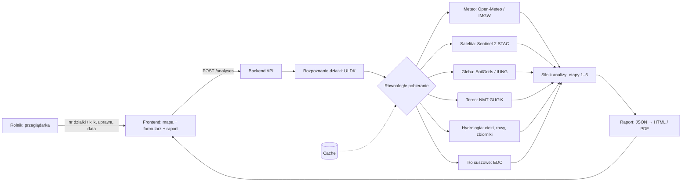

# ROSA: architektura

**R**etencja · **O**pady · **S**usza · **A**naliza

Narzędzie webowe dla rolnika: numer działki ewidencyjnej (albo kliknięcie na mapie) + uprawa + data analizy → ocena sytuacji wodnej, przyczyny, rekomendacje retencyjne i agrotechniczne, opcjonalnie nawadnianie. Zadanie KOWR „Zatrzymaj Wodę, Chroń Plony”, HackNation 2026.

Status: szkic, wersja robocza z 21.11.2026.

## 1. Wymagania, które kształtują architekturę

| Wymaganie (źródło: treść zadania KOWR) | Konsekwencja dla architektury |
|---|---|
| Dowolna działka w Polsce, podana numerem | Geometria zawsze z ULDK GUGiK na żądanie, bez lokalnej bazy działek |
| Data analizy: dziś **lub dowolna z ostatnich 10 lat** | Data jest parametrem całego pipeline'u; każde źródło pytane o okno względem tej daty |
| Wynik liczony z pobranych danych, nie z gotowych tekstów | Deterministyczny silnik analizy; każda rekomendacja ma przypięte dowody (wartość, źródło, data) |
| Kolejność: ocena → przyczyny → retencja → agrotechnika → (nawadnianie) | Pipeline etapowy; kolejny etap dostaje wyniki poprzedniego, nie surowe dane |
| Ograniczenia i niepewność pokazane wprost | Każde źródło zwraca też metadane jakości (pokrycie, rozdzielczość, zachmurzenie, brak danych) |
| Preferowane < 30 s na działkę | Równoległe pobieranie, odczyt tylko wycinków rastrów (COG), cache |
| Bez instalacji, bez płatności, bez GIS | Aplikacja webowa; wyłącznie darmowe, otwarte źródła |
| Raport do zapisania / wydruku | Widok raportu HTML + eksport PDF |
| README: źródła, licencje, co na żywo, a co wcześniej pobrane | Rejestr źródeł danych w kodzie (`sources`), z którego generujemy sekcję dokumentacji i stopkę raportu |

## 2. Widok ogólny

## 3. Komponenty

### 3.1 Frontend
- Mapa (MapLibre GL) z podkładem ortofoto z Geoportalu i obrysem działki.
- Formularz: numer działki **albo** kliknięcie na mapie, uprawa z listy, data analizy (domyślnie dziś).
- Widok raportu w prostym języku: stan wody, przyczyny, rekomendacje, „skąd to wiemy”, „czego nie wiemy”.
- Eksport do PDF i wydruk.
- Działa w Chrome, Firefoksie, Edge'u, Safari i Operze; widok mobilny jako dodatek.

### 3.2 Backend API
- Python, bo przetwarzanie rastrów i danych przestrzennych ma tam najlepsze biblioteki (rasterio, shapely, pyproj, pystac-client, numpy).
- Asynchroniczne pobieranie (httpx + asyncio) z osobnym timeoutem dla każdego źródła; awaria jednego źródła obniża pewność wyniku, ale nie wywraca analizy.
- Endpointy (wstępnie):
  - `GET /parcels/resolve?id=...` lub `?lat=&lon=`: geometria, TERYT, gmina, powierzchnia.
  - `POST /analyses` { parcelId, crop, date }: zwraca raport JSON.
  - `GET /analyses/{id}` i `GET /analyses/{id}.pdf`: zapisany raport.
  - `GET /crops`: lista upraw z parametrami.

### 3.3 Adaptery źródeł danych
Każdy adapter ma ten sam kontrakt: wejście (geometria działki, data analizy), wyjście (wartości + metadane jakości + opis źródła i licencji).

| Źródło | Co bierzemy | Sprawdzone | Uwagi |
|---|---|---|---|
| **ULDK GUGiK** | Geometria działki po ID (`GetParcelById`) i po punkcie (`GetParcelByXY`), TERYT, gmina, obręb | ✅ działa, WKT w EPSG:4326 | Szybkie, bez klucza |
| **Open-Meteo Archive** (ERA5 / ERA5-Land) | Dzienne: opad, Tmax, Tśr, **ET0 wg FAO-56**; godzinowe: wilgotność gleby 0–7, 7–28, 28–100 cm | ✅ działa | Rozdzielczość ok. 9–25 km; archiwum ma kilka dni opóźnienia, więc dla „dziś” dokładamy API prognozowe z `past_days` |
| **Sentinel-2 L2A** (Earth Search STAC, AWS) | Kanały red, nir, swir16 i maska scl jako COG → NDVI, NDMI dla działki | ✅ działa, bez konta | Czytamy tylko wycinek rastra o rozmiarze działki; zachmurzenie filtrujemy maską SCL |
| **ISRIC SoilGrids** | Ił, piasek, pył, węgiel organiczny, gęstość objętościowa (0–30 cm) | ⚠️ działa, ale 11–15 s (REST i COG) | Wyciąć Polskę raz i trzymać lokalnie (mały raster 250 m) |
| **IUNG-PIB** | Kategorie podatności gleb na suszę (warstwa `Susza:katgl_landuse2024`) | ✅ działa: WMS GetFeatureInfo na `sgeo.iung.pl/geoserver/Susza/wms`, ok. 0,5–0,7 s | Zwraca `GRAY_INDEX`; trzeba ustalić legendę kategorii |
| **NMT GUGiK** | Wysokości → spadek, ekspozycja, obniżenia terenu w obrębie działki | ✅ `GetHByPointList` (siatka 64 pkt): 0,9–1,3 s. ⚠️ WCS 1 m działa, ale ok. 18 s na 300×300 m | Zapas: Copernicus DEM 30 m (COG na AWS), 1,5–1,8 s |
| **Hydrologia** (BDOT10k) | Cieki, rowy melioracyjne, zbiorniki w sąsiedztwie działki | ✅ paczki na powiat z `opendata.geoportal.gov.pl/bdot10k/` (ok. 25 MB/powiat) → lokalna baza | Overpass (OSM) nie odpowiadał; usługi Wody Polskie zwracają 401 |
| **IMGW-PIB** | Pomiary ze stacji | ⏳ opcjonalnie | Do walidacji danych reanalizy |
| **European Drought Observatory** (WMS) | Wskaźnik CDI jako tło | ⏳ opcjonalnie | Kontekst regionalny i kontrola spójności |

### 3.4 Silnik analizy
Deterministyczny, regułowy, parametry w plikach konfiguracyjnych (progi, współczynniki upraw), żeby eksperci mogli je zmieniać bez dotykania kodu. Etapy zgodnie z załącznikiem „Podstawy naukowe”:

1. **Ocena sytuacji wodnej**
   - Klimatyczny bilans wodny P − ET0 dla 30, 60 i 90 dni przed datą analizy, porównany z tym samym oknem w 10 poprzednich latach (percentyl lub anomalia).
   - Wilgotność gleby z reanalizy na tle 10 lat.
   - NDVI i NDMI działki na tle tego samego okresu w poprzednich latach, z uwzględnieniem uprawy i fazy wegetacji.
   - Osobno: **bieżący niedobór** i **wieloletnia podatność** (jak często w ciągu 10 lat występował deficyt w tym okresie).
2. **Przyczyny**: reguły łączące sygnały z kategoriami przyczyn:
   - deficyt opadów + wysoka temperatura / ET0,
   - mała pojemność wodna gleby (lekka gleba, mało węgla organicznego),
   - nadmierny spływ (spadek terenu, brak elementów spowalniających odpływ),
   - wrażliwość uprawy w danej fazie.
3. **Rekomendacje retencyjne**: krajobrazowe (zatrzymanie wody w obniżeniach, na rowach, oczka wodne, strefy buforowe), uzasadnione terenem i hydrologią.
4. **Rekomendacje agrotechniczne**: międzyplony, resztki pożniwne, uproszczona uprawa, zwiększanie próchnicy; dobór według gleby i uprawy.
5. **Nawadnianie (opcjonalnie)**: zapotrzebowanie uprawy ETc = Kc × ET0 (FAO-56) minus opad efektywny → czy nawadniać, kiedy i ile.

Każdy wniosek ma: treść, wartości liczbowe, z których wynika, źródło i datę danych, poziom pewności.

### 3.5 Niepewność i braki danych
- Ocena kompletności: które źródła odpowiedziały, ile scen satelitarnych było bez chmur, rozdzielczość każdego źródła względem wielkości działki.
- Pewność wyniku liczona z kompletności i zgodności sygnałów (np. meteo mówi „sucho”, a NDVI „w normie” → niższa pewność i komentarz).
- Brak danych jest pokazywany wprost („brak bezchmurnych zdjęć z ostatnich 20 dni”), bez zastępowania go wartością domyślną.

### 3.6 Warstwa językowa (opcjonalna)
- Domyślnie raport składany z szablonów, więc działa bez żadnego modelu.
- Ewentualny LLM wyłącznie przeformułowuje gotowe wnioski na prostszy język; nie liczy i nie dodaje treści. Musi to być darmowy lub otwarty model i musi być opisany w dokumentacji (wymóg zadania).

### 3.7 Raport
- Jeden obiekt JSON → widok HTML i PDF.
- Sekcje: podsumowanie w 3 zdaniach, stan wody, przyczyny, rekomendacje (retencja → agrotechnika → nawadnianie), dane i źródła z datami, ograniczenia.

### 3.8 Cache i wydajność
- Cache odpowiedzi źródeł po kluczu (źródło, komórka siatki lub kafel, zakres dat).
- Klimatologia 10-letnia dla komórki ERA5 jest wspólna dla wielu działek, więc liczona raz i zapamiętywana.
- Satelita: wyszukiwanie STAC + odczyt wycinków COG dla daty analizy i tego samego okna w 10 latach, równolegle.
- Budżet czasu (cel, do zmierzenia):

| Krok | Cel |
|---|---|
| ULDK | < 1 s |
| Meteo 10 lat | < 3 s |
| Sentinel-2 (do 11 scen, wycinki) | < 15 s |
| Gleba, teren, hydrologia | < 5 s, równolegle z satelitą |
| Analiza + raport | < 1 s |
| **Razem** | **< 30 s**, z cache znacznie mniej |

## 4. Stos technologiczny (propozycja)

| Warstwa | Wybór | Dlaczego |
|---|---|---|
| Backend | Python 3.12+, FastAPI, httpx, rasterio, shapely, pyproj, pystac-client, numpy | Najlepsze biblioteki geo i rastrowe |
| Frontend | Next.js + shadcn/ui + MapLibre GL | Szybkie budowanie czytelnego UI, darmowa biblioteka map |
| PDF | Druk z przeglądarki albo generowanie po stronie serwera | Do decyzji |
| Baza | PostgreSQL + PostGIS | Działki, cieki i zbiorniki, wyniki analiz i cache; indeksy przestrzenne (GiST), zapytania o najbliższy rów (KNN), gotowy hosting |
| Cache | Tabele w Postgresie na start, Redis przy skalowaniu | Jedna baza mniej do utrzymania |
| Uruchomienie | Docker Compose, jedna komenda | Jury musi samo uruchomić prototyp |
| Hosting demo | Do decyzji | Jury potrzebuje działającego linku |

## 5. Testy i walidacja
- Zestaw kilkunastu działek referencyjnych z różnych regionów (gleby lekkie i ciężkie, teren płaski i nachylony) z kilkoma datami, w tym znane lata suszy.
- Porównanie naszej oceny z monitoringiem suszy IUNG i z EDO dla tych samych miejsc i dat.
- Testy odporności: nieistniejący numer działki, brak bezchmurnych scen, niedziałające źródło, data spoza zakresu.
- Pomiar czasu dla każdej działki referencyjnej.

## 6. Skalowanie (sekcja wymagana w dokumentacji)
- Limity zewnętrznych API: cache, kolejkowanie, ograniczanie liczby zapytań, ewentualnie własne kopie klimatologii.
- Aktualizacja danych: meteo i satelita codziennie, gleba i teren statyczne.
- Koszty: hosting backendu z obsługą rastrów, miejsce na cache; brak płatnych API.

## 7. Otwarte decyzje i ryzyka
- [ ] Dostęp maszynowy do kategorii podatności gleb z IUNG.
- [ ] Endpoint WCS dla NMT i rozmiar odpowiedzi dla pojedynczej działki.
- [ ] Źródło cieków i rowów (MPHP, BDOT10k): format, licencja, szybkość.
- [ ] Zachmurzenie: co robić, gdy w oknie daty nie ma czystej sceny (poszerzenie okna, Sentinel-1 radarowo).
- [ ] Lista upraw i współczynniki Kc oraz okresy krytyczne (FAO-56) do konfiguracji.
- [ ] Hosting działającej wersji dla jury.
- [ ] Czy używamy LLM, a jeśli tak, to jakiego (darmowy, opisany w dokumentacji).

## 8. Źródła wiedzy
- Treść zadania KOWR i załącznik „Podstawy naukowe” (`../drive-download-20261121T101008Z-1-001/[Krajowy Ośrodek Wsparcia Rolnictwa] Zatrzymaj Wodę, Chroń Plony/`).
- FAO-56: Crop evapotranspiration (Allen i in.).
- IUNG-PIB: Podstawy Systemu Monitoringu Suszy Rolniczej.
- KE: Natural Water Retention Measures.
- POLSA (2024): Dane satelitarne dla administracji publicznej, rozdz. 6.3.3 i 6.3.4.
- CDR Brwinów (2025): Melioracje, retencja i gospodarka wodna w rolnictwie.

## 9. Pomiary (21.11.2026)

Działka testowa `302604_5.0017.5196` (Mórka, gm. Śrem, 17,6 ha), data analizy 2025-07-15, wszystkie źródła odpytywane równolegle z Polski. Skrypty pomiarowe: `scratchpad/bench/` (poza repo).

| Źródło | Czas | Wniosek |
|---|---|---|
| ULDK (geometria działki) | 0,6–1,1 s | Albo lokalnie z Parquetu EGiB |
| Open-Meteo, **10 lat dziennie** w 1 zapytaniu (opad, ET0, Tmax, wilgotność gleby 0–7 i 28–100 cm) | 0,6–1,5 s | Na żywo |
| IUNG kategoria gleby | 0,5–0,7 s | Na żywo + cache |
| NMT GUGiK, 64 punkty | 0,9–1,3 s | Na żywo |
| Copernicus DEM 30 m (wycinek) | 1,5–1,8 s | Zapas dla NMT |
| SoilGrids | **11–15 s** | ❌ za wolno → lokalny wycinek Polski |
| Sentinel-2: wyszukiwanie STAC | 0,7 s (11 lat: 1,4 s) | OK |
| Sentinel-2: 1 scena, 4 kanały równolegle | ok. 3,7 s | Każde otwarcie COG z AWS us-west-2 to 2–3,7 s |
| Sentinel-2: 10 lat (21 plików równolegle) | **25–38 s** | ❌ nie da się na żywo; dla 4 z 11 lat brak sceny w oknie |
| WCS NMT 1 m | ok. 18 s | ❌ nie na żywo |

Wynik całości: **14,7 s** z 1 sceną Sentinel-2, **38,8 s** z 10 latami. Bez SoilGrids na żywo i z historią satelitarną spoza ścieżki zapytania: **ok. 4–5 s**, z czego prawie całość to jedna bieżąca scena Sentinel-2.

### Plan na < 5 s
- **Lokalnie** (PostgreSQL + PostGIS): działki z `0_dzialki.parquet` (4,6 GB, aktualizowany codziennie), cieki i zbiorniki z BDOT10k, wycinek SoilGrids dla Polski.
- **Na żywo, równolegle**: Open-Meteo, IUNG, NMT (punkty), jedna bieżąca scena Sentinel-2.
- **Historia NDVI z 10 lat**: nie w ścieżce zapytania. Do sprawdzenia: Sentinel Hub Statistical API w Copernicus Data Space (szereg czasowy dla wielokąta w jednym zapytaniu, darmowe konto z limitem), albo liczenie w tle i cache dla działki.
